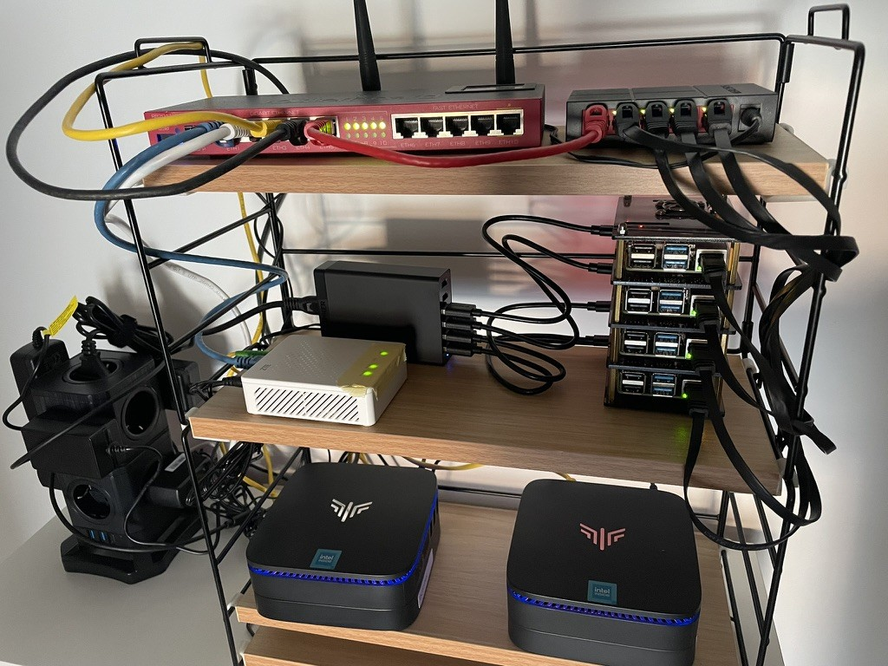
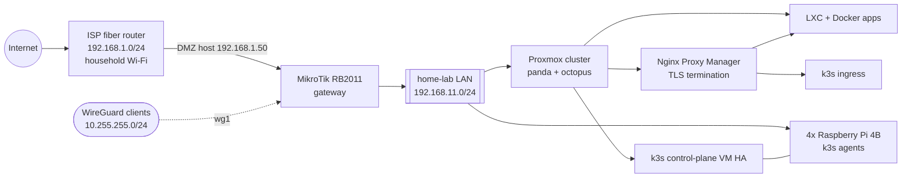

# home-lab-briefing

A starting point for understanding and accessing the resources that make up my home lab.

This repo is the **welcome page** — for humans and for LLM agents. It holds only the facts that span the whole
lab (network plan, domain, service catalog, hardware, energy, security posture) and points to a dedicated
repository for everything else. If you are an agent, read [AGENTS.md](AGENTS.md) next.

- [Repositories](#repositories)
- [Big picture](#big-picture)
- [Network plan](#network-plan)
- [Domain & service catalog](#domain--service-catalog)
- [Hardware](#hardware)
- [Clusters](#clusters)
- [Energy cost](#energy-cost)
- [Security](#security)

## Repositories

| Repository | Owns |
|---|---|
| [home-lab-briefing](https://github.com/bounteous17/home-lab-briefing) (this repo) | Lab-wide facts: CIDR plan, domain & catalog, hardware, energy, general security |
| [home-lab-mikrotik-gateway-iac](https://github.com/bounteous17/home-lab-mikrotik-gateway-iac) | MikroTik gateway: interfaces/bridges, DHCP reservations, DNS, firewall, NAT & hairpin, WireGuard |
| [home-lab-proxmox-ansible](https://github.com/bounteous17/home-lab-proxmox-ansible) | Proxmox VE cluster: nodes, HA, storage, backups, networking, VMs/LXCs (incl. Nginx Proxy Manager) |
| [home-lab-k3s-ansible](https://github.com/bounteous17/home-lab-k3s-ansible) | k3s cluster provisioning: control-plane VM + Raspberry Pi agents |
| [home-lab-k3s-argocd](https://github.com/bounteous17/home-lab-k3s-argocd) | Apps running on k3s, deployed GitOps-style with Argo CD |
| `home-lab-os-ansible` (planned, not created yet) | OS patching for every host: Raspberry Pis, Arch control-plane VM, Proxmox nodes |

## Big picture

Everything lives physically in the same place, on one shelf:

Top shelf: MikroTik gateway (left) and the 5-port gigabit switch (right). Middle: UPS (white box), USB power
hub and the 4 Raspberry Pi 4B. Bottom: the two Intel N95 mini PCs running Proxmox VE.

- The ISP router is the home's main router and provides Wi-Fi to every household device (laptops, phones; no IoT).
- The MikroTik is **not** the home router: it sits behind the ISP router as its DMZ host and is the gateway of
  the lab. All lab devices are wired to it (directly or through the 5-port switch); its Wi-Fi is disabled.
- Two clusters run on top: a **Proxmox VE** cluster on the mini PCs and a **k3s** cluster whose control plane is
  an HA VM on Proxmox and whose agents are the Raspberry Pis.

## Network plan

| Network | CIDR | Gateway | Purpose |
|---|---|---|---|
| ISP LAN | 192.168.1.0/24 | 192.168.1.1 (ISP router, Movistar GPT-2541GNAC) | Household devices. MikroTik WAN `ether1` = 192.168.1.50 (DHCP reservation, DMZ host) |
| people | 192.168.10.0/24 | 192.168.10.1 (MikroTik) | Home-devices network on the MikroTik — **unused** (household uses ISP Wi-Fi) |
| home-lab | 192.168.11.0/24 | 192.168.11.1 (MikroTik) | All home-lab hardware, VMs and containers |
| WireGuard | 10.255.255.0/24 | 10.255.255.1 (MikroTik `wg1`) | Remote clients; each peer gets a /32 |

Address plan inside 192.168.11.0/24. Each range is allocated **sequentially from its lowest free address**
(no gaps; a freed address is reused by the next guest):

| Range | Reserved for | Allocated |
|---|---|---|
| .1 | MikroTik gateway | `.1` |
| .2–.9 | Free for future use | — |
| .10–.29 | Proxmox LXCs | `.10` Nginx Proxy Manager, `.11` Vaultwarden |
| .30–.49 | Proxmox VMs | `.30` `k3s-control-plane` |
| .50–.59 | Raspberry Pis (k3s agents) | `.50` `eagle`, `.51` `lion`, `.52` `penguin`, `.53` `shark` (alphabetical) |
| .60–.99 | Free for future use | — |
| .100–.109 | **Proxmox host machines** (the mini PCs) | `.100` `panda`, `.101` `octopus` |
| .110–.199 | Free for future use | — |
| .200–.254 | DHCP pool (dynamic leases only) | — |

Everything below `.200` is static or a router reservation, so the DHCP pool never overlaps a planned address.
DHCP reservations, bridges and port mapping live in
[home-lab-mikrotik-gateway-iac](https://github.com/bounteous17/home-lab-mikrotik-gateway-iac).

## Domain & service catalog

All services are published under the custom domain **`begoodguys.ovh`** as `<service>.begoodguys.ovh`.

How a request reaches a service:

1. Public DNS at OVH points `*.begoodguys.ovh` to the MikroTik DynDNS name, i.e. the ISP fiber public IP.
2. The ISP router forwards everything to its DMZ host (the MikroTik); the MikroTik dst-nats TCP 80/443 to
   **Nginx Proxy Manager** (NPM) (its NAT rules 2/3, the only dst-NAT rules left). Lab and VPN clients resolve the same
   public IP and reach NPM through **hairpin NAT**.
3. NPM terminates TLS and reverse-proxies to the backend: an LXC container with Docker on Proxmox, or the k3s ingress.

> **Public reachability (verified 2026-11-02).** Because of the DMZ strategy, every service published through NPM is
> **reachable from the Internet**, not only from the LAN/VPN. Verified with external probes (check-host.net):
> `http://vaultwarden.begoodguys.ovh/` answers 301 and `https://` serves the Vaultwarden login page. See
> [Security](#security).

| Service | URL | Runs on | Details in |
|---|---|---|---|
| Vaultwarden | https://vaultwarden.begoodguys.ovh | Proxmox LXC (Docker) | [proxmox](https://github.com/bounteous17/home-lab-proxmox-ansible) |
| Immich | https://immich.begoodguys.ovh | Proxmox LXC (Docker) | [proxmox](https://github.com/bounteous17/home-lab-proxmox-ansible) |
| Jellyfin | https://jellyfin.begoodguys.ovh | Proxmox LXC (Docker) | [proxmox](https://github.com/bounteous17/home-lab-proxmox-ansible) |
| qBittorrent | https://qbittorrent.begoodguys.ovh | k3s | [k3s-argocd](https://github.com/bounteous17/home-lab-k3s-argocd) |
| Linkwarden | https://linkwarden.begoodguys.ovh | k3s | [k3s-argocd](https://github.com/bounteous17/home-lab-k3s-argocd) |
| Nextcloud | https://nextcloud.begoodguys.ovh | k3s | [k3s-argocd](https://github.com/bounteous17/home-lab-k3s-argocd) |

Infrastructure UIs:

| UI | URL | Runs on | Details in |
|---|---|---|---|
| Proxmox VE | https://proxmox.begoodguys.ovh | Proxmox cluster | [proxmox](https://github.com/bounteous17/home-lab-proxmox-ansible) |
| Nginx Proxy Manager | https://npm.begoodguys.ovh | Proxmox LXC | [proxmox](https://github.com/bounteous17/home-lab-proxmox-ansible) |
| Argo CD | https://argocd.begoodguys.ovh | k3s | [k3s-argocd](https://github.com/bounteous17/home-lab-k3s-argocd) |

Immich and Jellyfin run as LXC containers rather than on k3s so they can use the mini PCs' full compute; the
Raspberry Pis and the control-plane VM are too small for media transcoding and ML workloads.

## Hardware

| Device | Qty | Hostname(s) | IP(s) | Specs | OS | Role |
|---|---|---|---|---|---|---|
| MikroTik RB2011UiAS-2HnD | 1 | — | 192.168.11.1 (lab), 192.168.1.50 (WAN) | MIPS 600 MHz, 128 MB RAM, 5× GbE + 5× FE ports | RouterOS 7.24.4 | Lab gateway, firewall, DHCP, WireGuard |
| Intel N95 mini PC | 2 | `panda`, `octopus` | .100, .101 | 4 cores, 8 GB RAM, 256 GB SATA SSD (ZFS) + 960 GB SATA SSD (spare) | Proxmox VE 9.2.2 (Debian 13) | Proxmox cluster nodes |
| Raspberry Pi 4 Model B (4 GB) | 4 | `home-lab-k3s-cluster-prod-<animal>`: `eagle`, `lion`, `penguin`, `shark` | .50, .51, .52, .53 | Cortex-A72 4 cores, 4 GB RAM, 64 GB microSD | Debian 13 (Raspberry Pi kernel 6.18) | k3s agents |
| 5-port gigabit switch (unmanaged) | 1 | — | — | 5× RJ45 1 GbE | — | Fan-out for lab devices |
| USB multi-port power hub | 1 | — | — | — | — | Powers the Raspberry Pis |
| UPS (battery) | 1 | — | — | — | — | Keeps all home-lab hardware **and the ISP router** powered during outages |

After a power cut the Raspberry Pis power on by themselves; **the mini PCs must be powered on manually**.

The two 960 GB SSDs are not used by Proxmox; they will move out of the mini PCs into a future external NFS
storage (not bought yet) for backups and media.

## Clusters

| Cluster | Members | Notes | Details in |
|---|---|---|---|
| Proxmox VE 9.2 (`homelab`) | `panda`, `octopus` | Hosts NPM, the LXC apps and the k3s control-plane VM, all HA-managed | [home-lab-proxmox-ansible](https://github.com/bounteous17/home-lab-proxmox-ansible) |
| k3s v1.35 | `k3s-control-plane` (VM) + `lion`, `eagle`, `shark`, `penguin` | Single control-plane node, meant to be covered by Proxmox HA | [home-lab-k3s-ansible](https://github.com/bounteous17/home-lab-k3s-ansible), [home-lab-k3s-argocd](https://github.com/bounteous17/home-lab-k3s-argocd) |

> **HA caveat:** the single k3s control plane is only as available as Proxmox HA makes it. Today the Proxmox
> cluster has 2 votes, no QDevice and no storage replication, so losing either node stops every HA guest
> (control plane, NPM, Vaultwarden). The fix (QDevice + ZFS replication) is on the
> [Proxmox roadmap](https://github.com/bounteous17/home-lab-proxmox-ansible).

## Energy cost

Estimated wall power at **average load** (services running, not idle, not saturated), at **0.12 €/kWh**.
The ISP router is household equipment and is excluded.

| Device | Qty | W each | W total |
|---|---|---|---|
| Intel N95 mini PC (Proxmox) | 2 | 12 | 24 |
| Raspberry Pi 4B (incl. USB hub losses) | 4 | 4.5 | 18 |
| MikroTik RB2011UiAS-2HnD | 1 | 7 | 7 |
| 5-port gigabit switch | 1 | 2.5 | 2.5 |
| UPS self-consumption | 1 | 5 | 5 |
| **Total** | | | **≈ 56.5 W** |

| Period | Energy | Cost |
|---|---|---|
| Day | 1.36 kWh | ≈ 0.16 € |
| Month (30 d) | 40.7 kWh | ≈ 4.88 € |
| Year | 494.9 kWh | ≈ 59.39 € |

Per-device figures are estimates from typical measurements for this hardware class (N95 mini PCs measured
2.4–2.8 W CPU package power via RAPL at current load; whole-system draw is higher). Replace with smart-plug
readings when available.

## Security

- **Standing exposure / known risk: the whole catalog is public.** The intent is that services are reachable from
  the home-lab network and WireGuard VPN clients only (not even the ISP LAN), but the DMZ strategy contradicts it:
  WAN 80/443 are dst-NATed to Nginx Proxy Manager, so **every service published through NPM is reachable from the
  Internet** (verified 2026-11-02, see [Domain & service catalog](#domain--service-catalog)). The only enforcement is
  **NPM access lists**: the router has no `input`/`forward` drops and no source restriction on the dst-NAT rules.
  Until that is fixed (restrict the dst-NAT/forward path to lab + VPN sources, or accept the exposure per service),
  treat every catalog service as Internet-facing: keep strong authentication and NPM access lists on each one.
- WAN traffic reaches the MikroTik only because it is the ISP router's DMZ host (Movistar GPT-2541GNAC, DMZ host
  192.168.1.50); the MikroTik is the lab's only edge firewall, and currently filters nothing inbound (see above).
- TLS is terminated at Nginx Proxy Manager for every `*.begoodguys.ovh` name.
- Router management is done over WireGuard or from the ISP LAN.
- Known gaps and their fixes are tracked in the repo that owns the component, including the gateway's missing
  lab/VPN-only enforcement, the NAT rule details and the 2026-11-02 legacy-rule cleanup and 443 fix (a DMZ-arriving
  packet has dst 192.168.1.50, the router's own address, so `dst-address-type=unicast` on the 443 rule never
  matched), in
  [home-lab-mikrotik-gateway-iac](https://github.com/bounteous17/home-lab-mikrotik-gateway-iac).
- **Diagnosing ingress problems:** test from *outside* the network (e.g. check-host.net) and compare
  `/ip firewall nat print stats` counters before/after; internal tests pass via hairpin NAT even when the WAN path is
  broken.
